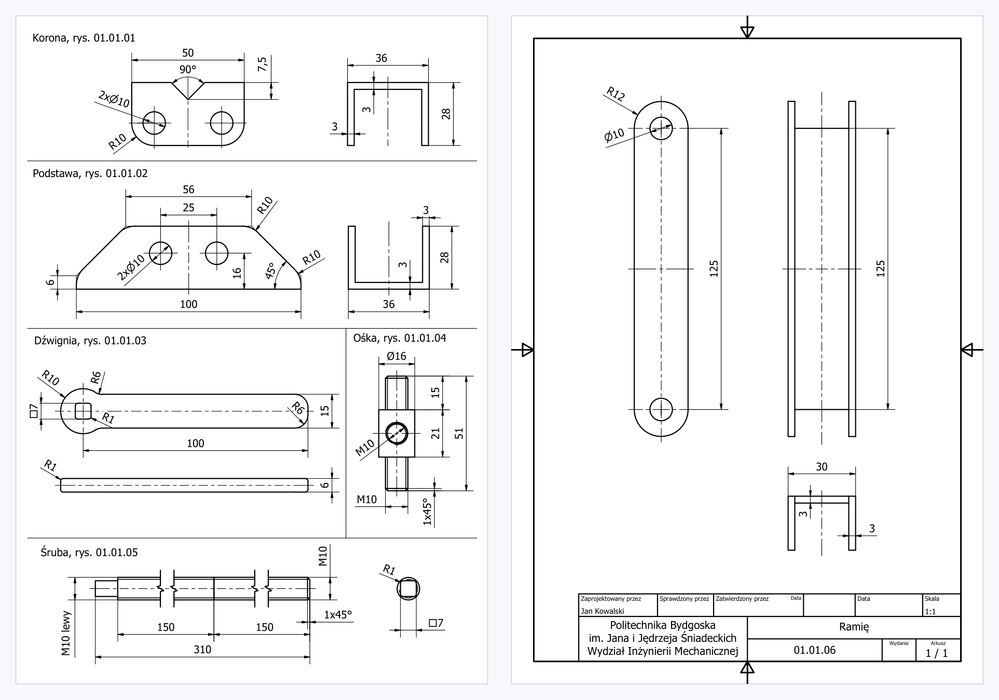
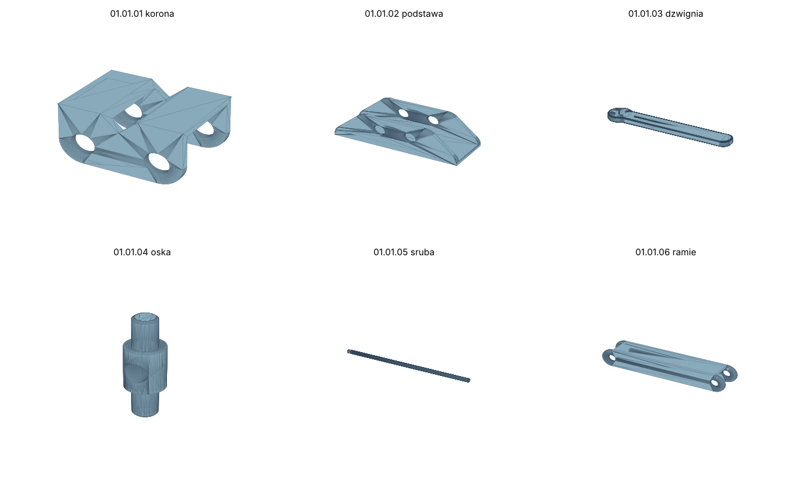

# drawing2cad

**2D engineering drawing (PDF) → 3D model (STEP) that checks itself against the drawing.**




- **What it does:** reads dimensions, tolerances and threads from a vector PDF, builds the solid in CadQuery/OpenCASCADE, then verifies it: every dimension is measured on the B-Rep geometry and the model's hidden-line projections are overlaid on the drawing's views.
- **Why:** recreating a 3D model when only the drawing exists. The key rule is **no silent guessing**: every part ends up `OK`, `NIEPEWNE` (uncertain, with a named reason) or `BŁĄD` (error).
- **Results:** on 35 stored AI answers for a 6-part car jack drawn in Autodesk Inventor, 9 were `OK`, all correct, **0 silent errors**. Also tested on 14 synthetic parts, each with several wrong variants, and on 29 real drawings from SolidWorks, AutoCAD and NIST (extraction only).

## How it works

1. **Extraction** (PyMuPDF): numbers come only from the PDF's vector text, never from the AI reading the image.
2. **Interpretation** (LLM, DeepSeek by default): the AI only assigns meaning to the extracted dimensions and picks parameters for 9 deterministic CAD building blocks. It writes no free-form CAD code.
3. **Build** (CadQuery): a repeatable solid from those parameters.
4. **Verification** (OpenCASCADE): dimension check on B-Rep (0.005 mm) plus a view comparison (HLR projections vs. PDF views, first-angle projection, mirror detection, edges not shown on the drawing). Up to 3 repair attempts with concrete error descriptions.
5. **Output:** STEP files, an HTML report, and a desktop app with a 3D viewer where the user can confirm or reject each assumption.

I ran the project with AI coding agents. My role: assumptions and requirements (including the "no silent errors" rule), design decisions, the test set, and checking the results with independent reviews and tests.

## Status

A finished prototype. It works on simple parts (shafts, bushings, flat bars, plates with holes) from vector PDFs. Sections, scans and complex solids are out of scope. The full documentation (in Polish) is in [README.md](README.md).

## Quick start (Windows, Python 3.12)

```powershell
py -3.12 -m venv .venv; .\.venv\Scripts\Activate.ps1
python -m pip install -e ".[dev,app]"
$env:PYTHONUTF8 = "1"
drawing2cad rysunki\cad_07_1.pdf --extract-only --out wyniki\   # free, no AI
drawing2cad-app                                                  # desktop app, "Demo offline" mode is free
python -m pytest -q -n 8 --dist load
```
