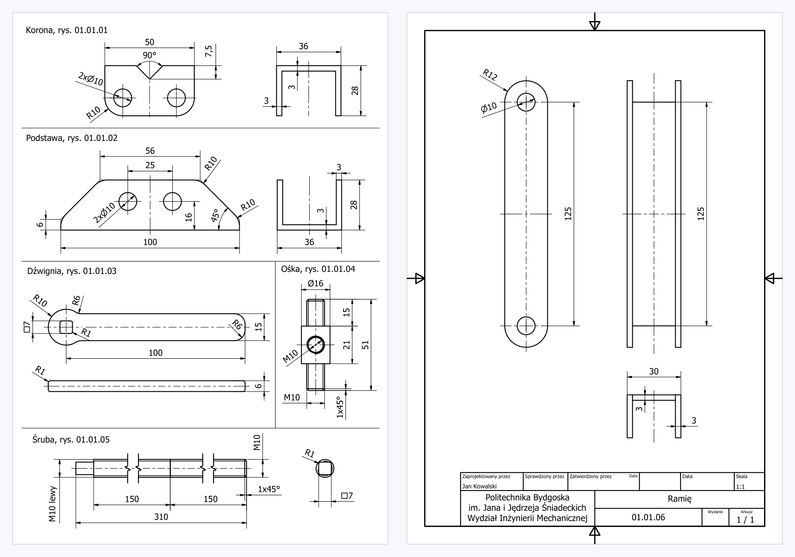
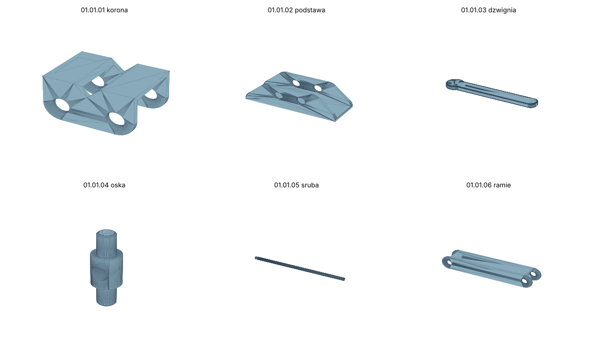
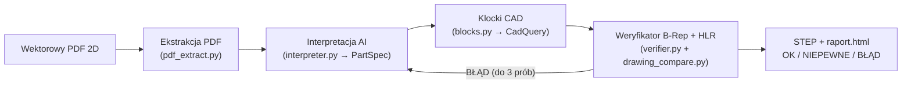

# drawing2cad

[](#znane-ograniczenia)
[](#instalacja-windows-powershell)
[](#architektura)
[](#wyniki-benchmark-etap-8)

**Rysunek techniczny 2D (PDF) → model 3D (STEP), który sam sprawdza, czy zgadza się z rysunkiem.**

- **Co robi:** czyta wymiary, tolerancje i gwinty z wektorowego PDF, buduje bryłę w CadQuery/OpenCASCADE i porównuje ją z rysunkiem: mierzy każdy wymiar na geometrii B-Rep i nakłada rzuty modelu na widoki z PDF.
- **Po co:** odtworzenie modelu 3D, gdy jest tylko rysunek. Ważniejsze od „zawsze coś zbudować” jest to, że program **nie zgaduje po cichu**: każda część dostaje `OK`, `NIEPEWNE` (z nazwanym powodem) albo `BŁĄD`.
- **Wynik:** na 35 zapisanych odpowiedziach AI dla 6 części podnośnika z Inventora 9 dostało `OK`, wszystkie poprawne, **0 cichych błędów**. Do tego 14 syntetycznych części, każda z kilkoma błędnymi wariantami, i 29 prawdziwych rysunków z SolidWorks, AutoCAD i NIST do testów ekstrakcji.

Projekt prowadziłem z wykorzystaniem agentów AI do pisania kodu; moja rola: założenia i wymagania (m.in. zasada „zero cichych błędów”), decyzje projektowe, zbiór testowy i weryfikacja wyników niezależnymi review i testami.

> [!NOTE]
> **Status: zakończony prototyp.** Działa na prostych częściach (wałki, tuleje, płaskowniki, płyty z otworami) z wektorowych PDF. Przekroje, skany i złożone bryły są poza zakresem; szczegóły w [Znanych ograniczeniach](#znane-ograniczenia). English summary: [README.en.md](README.en.md).

## Podgląd: od rysunku 2D (PDF) do brył 3D (STEP)

| Wejście: wektorowy PDF (Autodesk Inventor) | Wyjście: bryły 3D (STEP) weryfikowane w OpenCASCADE |
| :---: | :---: |
|  |  |
| *Arkusz `rysunki/cad_07_1.pdf` — 6 części podnośnika (automatyczny podział arkusza, ekstrakcja wymiarów i wektorów widoków).* | *6 części 3D ze zbioru `podnosnik-testset` (`Korona`, `Podstawa`, `Dźwignia`, `Ośka`, `Śruba`, `Ramię`).* |

## Kluczowe założenia

- **Liczby wyłącznie z wektorów PDF** — wymiary, tolerancje, symbole (`Ø`, `□`, gwinty) i BOM są wyciągane deterministycznie z PDF (PyMuPDF), nigdy nie są „czytane na oko” przez AI.
- **Deterministyczne klocki CAD** — AI nie pisze dowolnego kodu OpenCASCADE; wybiera parametry ze schematu `PartSpec`, z których budowana jest powtarzalna bryła w CadQuery.
- **Dwustopniowa weryfikacja geometryczna** — weryfikator mierzy bryłę B-Rep w OpenCASCADE (tolerancja `0,005 mm`) oraz porównuje rzuty modelu z ukrytymi liniami (HLR) z widokami wektorowymi PDF (rzut europejski, wykrywanie odbić lustrzanych i niepokazanych krawędzi).
- **Zero cichych błędów** — w przypadku niejednoznaczności rysunku program oznacza część jako `NIEPEWNE` (z nazwanym powodem) i potrafi zapytać użytkownika o potwierdzenie założeń (`--pytaj`).

## Architektura



1. **Ekstrakcja wektorowa PDF (`pdf_extract.py`)**: liczby pochodzą wyłącznie z tekstu
   wektorowego PDF (PyMuPDF), nigdy od AI. Moduł:
   - dekoduje znaki, których PDF nie mapuje na Unicode (np. polskie litery Inventora), przez
     tablicę cmap czcionki osadzonej w PDF; symbole czcionki `AIGDT` (`P→Ø`, `Q→□`),
   - grupuje obrócone i pochylone napisy wzdłuż kierunku tekstu (`M10 lewy`, `2xØ10`, `□7`, `1x45°`),
   - dzieli arkusze wieloczęściowe po liniach podziału, znajduje tabelkę rysunkową (linie
     przylegające do ramki) i BOM (kolumny z linii tabeli), wyciąga wymiary złożenia bez numerów pozycji,
   - renderuje wycinki PNG każdej części dla AI i raportu HTML.
2. **Interpretacja AI (`interpreter.py`)**: model z obsługą obrazów (domyślnie DeepSeek przez API
   zgodne z OpenAI, opcjonalnie Anthropic) zwraca JSON zgodny ze schematem `PartSpec`:
   przypisuje wymiarom znaczenie i wybiera klocki CAD. Cache odpowiedzi jest kluczowany skrótem
   dostawcy, adresu API, modelu, limitu tokenów, promptu systemowego ze schematem, promptu i obrazu.
   Błędy, których ponowienie nie naprawi (brak klucza, brak w cache offline, ucięta odpowiedź),
   kończą pętlę od razu.
3. **Biblioteka klocków CAD (`blocks.py`)**: deterministyczna budowa brył w CadQuery z 9 klocków:
   `plyta_z_profilu`, `ceownik`, `walec`, `czop_kwadratowy`, `otwor`, `otwor_kwadratowy`,
   `wyciecie_v`, `zaokraglenie_krawedzi`, `fazka`. Jedna konwencja współrzędnych dla wszystkich osi.
4. **Weryfikator (`verifier.py`, `drawing_compare.py`)** ma dwie niezależne części:
   - *wymiary*: mierzy bryłę w OpenCASCADE i odhacza każdy wymiar PDF (tolerancja 0,005 mm).
     Typ wymiaru musi pasować do cechy (Ø nie może być sprawdzana jako R), krotność `2x` pochodzi
     z PDF, jedna cecha modelu nie zalicza dwóch wymiarów (np. dwie grubości 3 mm muszą być
     w różnych kierunkach), każdy otwór modelu musi mieć swój wymiar, otwór bez wymiaru głębokości
     musi być przelotowy (pogłębienie kończy się na odsadzeniu, więc też potrzebuje wymiaru głębokości),
     długości gwintów muszą mieścić się na zmierzonym walcu, Ø okręgu podziałowego (np. 4xØ9 na Ø60)
     jest sprawdzana jako okrąg przez osie otworów, położenie otworu może być zwymiarowane od dowolnej
     płaskiej ściany równoległej do jego osi (np. od podsypania łba sworznia);
   - *widoki*: każdy widok rysunku (linie widoczne z wektorowego PDF, grubości rozpoznawane na
     każdej stronie osobno) jest porównywany z rzutem modelu z ukrytymi liniami (HLR):
     - wszystkie widoki części muszą dać się wyjaśnić jedną orientacją modelu i jedną skalą,
       ułożone w rzucie europejskim (zgodność tylko z amerykańskim = `NIEPEWNE`); to odrzuca
       odbicia lustrzane,
     - każda linia rysunku musi leżeć na krawędzi modelu i odwrotnie (tolerancja 0,1 mm),
     - każda ostra krawędź modelu musi mieć odpowiednik w którymś widoku (element niewidoczny
       na rysunku, np. ślepy otwór albo wnęka, to `BŁĄD`),
     - łuk narysowany w granicach 3 % promienia z wymiaru musi mieć dokładnie ten promień,
     - obsługuje widoki przerwane (ukryta część musi mieć stały przekrój), umowne oznaczenia
       gwintów, linie kreskowane; przekrój i aksonometria dają przy niezgodności `NIEPEWNE`;
   - *dokładność ponad rysunek*: gabaryty, stopnie wałków i położenie każdego otworu (także każdego
     otworu z szeregu, końców fasolki i otworów kwadratowych) muszą dokładnie wynikać z liczb rysunku
     (sumy do 4 wymiarów lub ich połówek), otwory pokazane symetrycznie muszą leżeć dokładnie na osi;
     w przeciwnym razie `NIEPEWNE` albo `BŁĄD` z nazwanym powodem.
   Bez porównania widoków wynik jest najwyżej `NIEPEWNE`, nigdy `OK`. Kierunek, którego nie pokazuje
   żaden widok, daje `NIEPEWNE`, chyba że to część toczona (średnica) albo płyta o stałej grubości
   (graniastosłup bez stopni, skosów i otworów poprzecznych) z wymiarem grubości, np. `g=3`.
5. **Pętla poprawek i niejednoznaczności (`pipeline.py`)**: do 3 prób z konkretnym opisem błędów
   (także położeniem niezgodnych linii w widoku). Niejednoznaczności są raportowane jako `NIEPEWNE`:
   zgłoszone przez AI oraz wykryte przez program (np. otwory bez wymiaru położenia).
6. **Raport HTML i CLI (`report.py`, `cli.py`)**: pliki `.step`, raport `raport.html` z wycinkami
   rysunków, tabelą wymiarów i tabelą widoków oraz podsumowanie w terminalu.

## Instalacja (Windows, PowerShell)

Wymagany Python 3.12 (CadQuery nie ma jeszcze pakietów dla 3.13+).

```powershell
py -3.12 -m venv .venv
.\.venv\Scripts\Activate.ps1
python -m pip install -e ".[dev]"
Copy-Item .env.example .env   # potem wpisz DEEPSEEK_API_KEY i LLM_MODEL w .env
$env:PYTHONUTF8 = "1"
```

## Konfiguracja AI (`.env`)

Domyślnie DeepSeek (tani, API zgodne z OpenAI). Model musi obsługiwać obrazy.
Nazwy modeli DeepSeek się zmieniają, więc sprawdź aktualną na
https://api-docs.deepseek.com i wpisz ją w `LLM_MODEL`.

| Zmienna | Znaczenie |
|---|---|
| `LLM_PROVIDER` | `deepseek` (domyślnie), `openai_compat` (np. OpenRouter), `anthropic` |
| `LLM_MODEL` | nazwa modelu |
| `DEEPSEEK_API_KEY` / `LLM_API_KEY` / `ANTHROPIC_API_KEY` | klucz wybranego dostawcy |
| `LLM_BASE_URL` | adres API dla `openai_compat` |
| `LLM_VISION` | `0` = bez obrazu (każda część dostaje wtedy `NIEPEWNE`) |

## Użycie

```powershell
# Pełny przebieg z AI (pyta o zgodę na koszt; odpowiedzi i dziennik kosztów w cache\)
drawing2cad rysunki\cad_07_1.pdf --out wyniki\ --cache-dir cache\ --max-cost 0.30

# Powtórka bez kosztów: tylko odpowiedzi już zapisane w cache\
drawing2cad rysunki\cad_07_1.pdf --offline --cache-dir cache\ --out wyniki\

# Pytania o założenia przy niejednoznacznościach (zasada 6): potwierdź / odrzuć;
# decyzje zapisują się w rysunki\cad_07_1.decyzje.json i działają przy kolejnych uruchomieniach
drawing2cad rysunki\cad_07_1.pdf --offline --cache-dir cache\ --out wyniki\ --pytaj

# Tylko ekstrakcja wektorowa PDF (obszary, wymiary, BOM, wycinki PNG)
drawing2cad rysunki\cad_07_1.pdf --extract-only --out wyniki\

# Test klocków ręcznymi specyfikacjami (bez AI, to nie jest benchmark)
drawing2cad rysunki\cad_07_1.pdf --reczne tests\fixtures\reczne --out wyniki\
```

## Aplikacja okienkowa

Interfejs graficzny (`src/drawing2cad/app/`): lokalny serwer FastAPI na `127.0.0.1` i strona otwierana
w natywnym oknie (pywebview, na Windows WebView2) albo w przeglądarce. Działa offline (three.js jest w pakiecie).

```powershell
python -m pip install -e ".[app]"
$env:PYTHONUTF8 = "1"
drawing2cad-app              # okno aplikacji
drawing2cad-app --browser    # ten sam interfejs w przeglądarce (http://127.0.0.1:8765/)
```

- Wybór PDF: przeciągnij i upuść, okno wyboru albo przykłady z `rysunki\`; można odznaczyć części.
- Tryby: **Demo offline** (zapisane prawdziwe odpowiedzi AI z `tests\fixtures\deepseek\odpowiedzi`, 0 wywołań API;
  `cad_07_1.pdf` daje 4 OK, 1 NIEPEWNE, 1 BŁĄD), **Ręczne specyfikacje** (`tests\fixtures\reczne`, bez AI),
  **Prawdziwy przebieg z AI** (konfiguracja z `.env`, cache w `cache\`). Płatny przebieg startuje dopiero po
  oknie z najgorszym kosztem i limitem `max_cost` oraz zaznaczeniu zgody; serwer odrzuca go bez potwierdzenia.
  Przebieg można przerwać: kolejne części nie są już wysyłane do AI.
- Wyniki: liczniki OK / NIEPEWNE / BŁĄD, karty części, wycinek rysunku obok interaktywnego modelu 3D
  (STEP konwertowany do STL i krawędzi B-Rep), tabele wymiarów i widoków, zastrzeżenia ze źródłem (AI / program),
  błędy, otwarcie / pobranie STEP, raport HTML, koszt AI.
- Zastrzeżenia można potwierdzić albo odrzucić przyciskami (jak `--pytaj` w CLI, ten sam plik
  `<rysunek>.decyzje.json` obok PDF); status części, `raport.json` i `raport.html` są wtedy przeliczane.
- Wyniki przebiegów trafiają do `wyniki\aplikacja\przebiegi\` i są widoczne w historii po ponownym uruchomieniu
  (`--work-dir` zmienia katalog, `--cache-dir` katalog cache AI).

## Testy

```powershell
$env:PYTHONUTF8 = "1"
python -m pytest -q -n 8 --dist load   # równolegle (ok. 2x szybciej)
python -m pytest -v
cd podnosnik-testset; python test_porownaj.py; cd ..
```

## Wyniki (benchmark, etap 8)

### Offline: wszystkie zapisane odpowiedzi AI (0 USD)

`tools/benchmark_offline.py` buduje i weryfikuje obecnym kodem każdą zapisaną prawdziwą odpowiedź
`deepseek-flash` (35 odpowiedzi z przebiegów 5-9, `tests/fixtures/deepseek/odpowiedzi/`) i porównuje
ją ze wzorcem (`podnosnik-testset/porownaj.py`, którego program nie widzi). To samo sprawdza test
`tests/test_real_answers.py`.

```powershell
python tools\benchmark_offline.py
```

| Status | Odpowiedzi | Zgodne ze wzorcem |
|---|---:|---|
| **OK** | 9 | 9 |
| **NIEPEWNE** | 8 | 7 (+1 niezgodna: R1 także w otworze □7, którego rysunek nie pokazuje; powód wskazany przez program) |
| **BŁĄD** | 18 | 1 (poprawna bryła, ale AI nie wpisało długości odcinków gwintu 150/150) |

- **Ciche błędy: 0.** Każda niezgodna odpowiedź ma `BŁĄD` albo `NIEPEWNE` z powodem znalezionym przez program.
- Korona nigdy nie dostaje `OK` (położenie otworów nie jest zwymiarowane), Dźwignia też nie (`R1` widoczne
  tylko na części krawędzi).
- **Ramię dostaje `OK`.** Długość środnika nie jest zwymiarowana wprost, ale widok z boku ma linie jego końców
  na wysokości otworów: ze środnikiem 125 mm pasują wszystkie 3 widoki, ze środnikiem 149 mm albo 100 mm nie.
  `ground_truth.json` (R-N2) ma tę uwagę jako informację, nie błąd rysunku.
- **Dźwignia nie przeszła pełnego przebiegu z AI** (próba 3 przerwana brakiem środków na koncie API) i projekt
  zamknięto bez kolejnego płatnego przebiegu.

### Ostatni przebieg z AI (przebieg 9, 2026-11-23)

| Nr | Część | Próby | Wzorzec |
|---|---|---:|---|
| 01.01.01 | Korona | 1 | ZGODNY |
| 01.01.02 | Podstawa | 1 | ZGODNY |
| 01.01.03 | Dźwignia | 3 | NIEZGODNY (próba 3 przerwana: brak środków na koncie API, 402) |
| 01.01.04 | Ośka | 1 | ZGODNY |
| 01.01.05 | Śruba | 1 | ZGODNY |
| 01.01.06 | Ramię | 2 | ZGODNY |

Statusy z obecnym kodem pokazuje benchmark offline powyżej. Złożenie `cad_08_1.pdf`: BOM 8/8 pozycji,
wymiar gabarytowy 180. Historia przebiegów 1-9 (od 0/6 do 5/6 zgodnych) jest w opisach commitów.

### Kiedy program daje `OK`

Uwagi AI o tym, jak czytać rysunek (waga „ostrzezenie”), uznaje za rozstrzygnięte tylko wtedy, gdy model
zgadza się ze wszystkimi wymiarami i widokami, każda krawędź jest wyjaśniona, nie ma niewidocznych
zaokrągleń i program nie ma żadnego własnego zastrzeżenia. Uwaga zostaje w raporcie z dopiskiem
„Rozstrzygnięte”. Uwagi AI o błędzie rysunku zawsze dają `NIEPEWNE`. Zastrzeżenia programu
(np. niewymiarowane położenie otworów) nie zależą od tego, co zgłosiło AI.

## Potwierdzanie założeń (zasada 6)

Z opcją `--pytaj` program przy każdym zastrzeżeniu (AI albo programu) pokazuje przyjęte założenie
i pyta: potwierdzam / odrzucam / pomiń. Potwierdzone zastrzeżenie zostaje w raporcie jako
„Potwierdzone przez użytkownika”, a część może dostać `OK`. Odrzucone daje `BŁĄD` z Twoim komentarzem.
Decyzja jest przypisana do dokładnej treści założenia: jeśli kolejny przebieg AI przyjmie coś innego,
program zapyta ponownie.

## Koszty AI

- Przed płatnym przebiegiem program pokazuje najgorszy przypadek i pyta o zgodę (`--yes` pomija pytanie;
  bez terminala i bez `--yes` nie wywoła API).
- Limit kosztu przebiegu: `LLM_MAX_COST` w `.env` albo `--max-cost` (domyślnie 0,50 USD). Po jego
  osiągnięciu kolejne części dostają `BŁĄD` „Limit kosztów” zamiast nowych wywołań.
- Każde wywołanie trafia do `cache\koszty.jsonl` (tokeny wejścia, cache, wyjścia, rozumowania, szacunek USD),
  a podsumowanie jest wypisywane na końcu. Ceny w `.env` (`LLM_PRICE_*`) są domyślnymi cenami z cennika
  i warto je porównać z rachunkiem dostawcy.
- Odpowiedzi z cache i tryb `--offline` nic nie kosztują.

## Znane ograniczenia

- **Status prototypowy:** biblioteka zawiera obecnie 9 klocków CAD i została przetestowana na jednym
  zestawie rysunków z Autodesk Inventora (6 części) oraz syntetycznych arkuszach. Bardziej złożone
  odlewy, powierzchnie swobodne czy nietypowe operacje wymagają rozbudowy klocków i reguł weryfikacji.
- **Dokładność rysunku ~0,05 mm.** Inventor zapisuje PDF ze skalą różną od 1:1 o ~0,1 %. Położenia
  niewymiarowane (z rysunku, nie z liczb) są sprawdzane z tolerancją 0,1 mm; mniejsze odchyłki łapią
  tylko reguły dokładności (gabaryty i stopnie z sum wymiarów, symetria, promienie z wymiarów) i dają
  wtedy `NIEPEWNE`.
- **Zaokrąglenia styczne niewidoczne w żadnym widoku** (np. `R1` także na krawędziach otworu) nie dają
  się sprawdzić z rysunku bez linii niewidocznych; program sam je wykrywa i daje `NIEPEWNE`, ale nie wie,
  czy powinny tam być. Zaokrąglenie toroidalne (np. stopień wałka) liczy się jako pokazane tylko w widoku
  patrzącym w poprzek jego osi, gdzie jego łuk profilu jest widoczny (nie zasłania go inna część bryły)
  i leży na narysowanej linii ciągłej; linie niewidoczne i umowne okręgi gwintu go nie potwierdzają.
- **Promień zaokrąglenia w widoku przerwanym.** W widoku przerwanym łuki nie są dopasowywane okręgiem
  (porównanie tylko z tolerancją położenia 0,1 mm), więc zaokrąglenie o promieniu nieco innym niż
  narysowany (np. `R2,2` zamiast `R2`, odchyłka łuku < 0,1 mm) przechodzi, jeśli rysunek nie ma osobnego
  wymiaru `R` tej krawędzi.
- Widoki przekrojów i aksonometrie: niezgodność daje `NIEPEWNE`, nie `BŁĄD` (nie są porównywane jak rzuty).
- Fazki na krawędziach ukośnych (nie równoległych do osi układu) nie są mierzone.
- **Orientacja modelu tylko co 90°.** Widoki są dopasowywane w 24 orientacjach osiowych. Część toczona,
  której szereg otworów AI obróci wokół osi części o kąt inny niż wielokrotność 90° (np. 4 otwory na
  podziałce o 45°), jest tą samą częścią, ale dostaje `BŁĄD` (test `xfail` w `tests/test_generalization.py`).
- Otwór, którego nie widać w żadnym narysowanym widoku (np. tuleja tylko w dwóch widokach z boku, bez linii
  niewidocznych), może mieć dowolne położenie; program daje wtedy `NIEPEWNE` (położenie niezwymiarowane).
- Tolerancje i pasowania (`Ø10H7`, `25±0,1`) są odczytywane i pokazywane w raporcie, ale model jest
  budowany i sprawdzany w wymiarze nominalnym.

### Rysunki spoza Inventora (SolidWorks, Fusion 360, AutoCAD, NIST PMI)

Sprawdzone na 29 PDF z `rysunki-zewnetrzne/` (tylko ekstrakcja; wyniki w `rysunki-zewnetrzne/MANIFEST.md`).
Co działa: kropka dziesiętna (`7.85`; numer rysunku to dopiero ≥2 separatory, np. `01.01.03`, albo pole
tabelki), numery stref ramki (`1–8`, `A–F`) i tabelka z polami po angielsku (`DRAWING NO.`, `MATERIAL`,
`WEIGHT`, `SCALE`…) są wyłączane z wymiarów, z tabelki brany jest numer, nazwa, skala i arkusz;
odchyłki pisane jedna nad drugą (`610 +0,01/-0,01`, `Ø45 g6 -0,009/-0,025`); symbol `Ø` narysowany
krzywymi (okrąg z ukośną kreską) przed liczbą, także przy wymiarach pod kątem; `2*M3`, `M30*1.5`,
`4X Ø10`, `10-0.1`. Każdy tekst z cyfrą na stronie, który nie jest wymiarem ani jego odchyłką, trafia do
nierozpoznanych (część najwyżej `NIEPEWNE`) albo — gdy to etykieta strefy ramki lub pole tabelki — zostaje
w `raw_texts` z oznaczeniem `[ramka]` / `[tabelka]`; test sprawdza to na tekście czytanym prosto ze strony.
Skan (sama grafika rastrowa) i brak jakiejkolwiek części dają `BŁĄD`, a `--extract-only` kończy się wtedy
kodem 1 (tak samo przy każdym innym błędzie ekstrakcji). Arkusze z tym samym numerem rysunku mają osobne
obrazy (`<nr>_s2.png`) i osobne pliki STEP.

Reguły, które wyłączają tekst z wymiarów, są celowo wąskie:
- strefy ramki: tylko rząd ≥4 kolejnych etykiet na jednej linii przy krawędzi arkusza, w równych
  odstępach i bez powtórzeń; pojedyncze liczby przy krawędzi zostają wymiarami;
- tabelka: zwarta grupa etykiet pól najbliżej prawego dolnego rogu; notatka gdzie indziej
  (`SURFACE FINISH`, `GENERAL TOLERANCES`) jej nie powiększa, a liczba w obszarze tabelki, która nie
  jest wartością pod etykietą ani nie leży we własnej komórce tabeli, jest dalej czytana jako wymiar;
- odchyłka pisana osobno trafia tylko do wymiaru o tym samym kierunku, najwyżej linię nad lub pod nim,
  który nie ma jeszcze kompletnej tolerancji; samotne `0` (rzędna) jest odchyłką tylko jako połowa pary;
- `Ø` z krzywych: okrąg (proporcje ~1:1, domknięty) i kreska pochylona jak `/` (40–85° do kierunku
  tekstu). Płaska kreska z grotami albo mały otwór z osią przed liczbą dają „rodzaj niepewny”, nigdy `Ø`.

Czego nadal nie ma:
- **Tekst zamieniony na krzywe** (eksport Fusion 360 przez DWG, PDF z PScript5/Distiller): wymiarów nie da
  się odczytać bez OCR. Program daje ostrzeżenie ekstrakcji i `BŁĄD` bez wywołania AI.
- **Rysunki w calach**: wykrywane (`UNITS: INCHES`, liczby `.250`), wartości nie są przeliczane; `BŁĄD`.
- **Widoki aksonometryczne z adnotacjami PMI/GD&T (NIST)**: tekst wzdłuż osi aksonometrycznych daje
  `BŁĄD`; na stronach, gdzie to nie zachodzi, ramki tolerancji geometrycznych (`0.65ABC`) i symbole
  czcionki GD&T AutoCADa (głębokość, pogłębienie) są tylko w nierozpoznanych, a pochylone napisy bywają
  sklejane z sąsiednimi (`4` + `3X Ø3.5` → `43X`).
- **Wielostronicowy rysunek jednej części** jest liczony jako tyle części, ile stron; gdy strony nie mają
  rozróżnialnych numerów rysunku, każda część dostaje ostrzeżenie (`NIEPEWNE`), ale arkusze nie są łączone.
- Inny symbol niż `Ø` narysowany krzywymi przed liczbą (np. `□`) nie jest odczytywany: wymiar dostaje
  „rodzaj niepewny” (`type_uncertain`, `NIEPEWNE`). Symbole w środku tekstu (`Ø5.6 X 90°` pogłębienia)
  i wymiary współrzędnych `0` trafiają do nierozpoznanych.
- Tabelka rozpoznawana po polach angielskich w prawym dolnym rogu; tabelki w innych językach albo w innym
  miejscu nie są wyłączane: ich liczby (masa, materiał) mogą zostać wzięte za wymiary (AI musi je
  powiązać, więc nie przejdą po cichu) albo trafić do nierozpoznanych. Tabela zmian (`REV.`) u góry
  arkusza nie jest rozpoznawana.
- Numer i nazwa z tabelki to tekst z komórki pod etykietą; w rysunkach Creality pole `DRAWING NO.`
  zawiera nazwę części, więc ona staje się numerem.
- `Ø` z krzywych w czcionce o innym pochyleniu kreski (np. prawie pionowej albo `\`) nie jest uznawany
  za średnicę: wymiar dostaje „rodzaj niepewny” (`NIEPEWNE`), choć mógł być poprawny.
- Uwaga o calach rozpoznawana jest w obrębie jednego tekstu (`UNITS: IN`, `UNITS: INCHES`); gdy `UNITS:` i
  `IN` są osobnymi napisami, rysunek wykrywa tylko reguła liczb bez zera (`.250`).
- Tabelka bez linii (same etykiety) jest wyłączana według położenia wartości pod etykietą; liczba stojąca
  w niej obok, a nie pod etykietą, wraca do wymiarów lub nierozpoznanych (`NIEPEWNE`, nie po cichu).
- Arkusze wieloczęściowe Inventora (podział liniami): tekst w pasie węższym niż 40 pt między liniami
  podziału albo poza polem strony nie należy do żadnej części i nie jest nigdzie zgłaszany. Na
  rysunkach złożeniowych (BOM) test „nic nie znika” nie jest uruchamiany: sprawdzane są tylko wymiary
  złożenia i BOM. Te ścieżki nie były zmieniane, żeby wynik Inventora pozostał identyczny.
- Tekst wystający poza pole strony (NIST: nagłówki wydruku z nazwą pliku) jest teraz czytany jak każdy
  inny, więc trafia do nierozpoznanych.

## Jak sprawdzano program

Siedem rund niezależnego review (Gemini, tylko do odczytu) znalazło łącznie kilkadziesiąt
przypadków, w których program dawał `OK` albo `NIEPEWNE` dla złego modelu. Każdy z nich jest teraz
testem w `tests/test_silent_errors.py` (sprawdzane, że model naprawdę jest NIEZGODNY ze wzorcem
i że program daje `BŁĄD` albo `NIEPEWNE` z właściwym powodem).

Uogólnienie poza podnośnik: `tests/test_generalization.py` rysuje arkusze (rzut europejski, linie
wymiarowe i osie cienką linią, ramka, tabelka, czasem linie niewidoczne, skale 1:2, 1:1, 2:1) dla
14 innych części: płyta z siatką otworów i wybraniem, kątownik gięty, wałek stopniowy z rowkiem
(1 widok), tuleja, kołnierz z otworami na podziałce, płaskownik z fasolką, płyta z otworem kwadratowym,
klocek ze skosem (3 widoki), podkładka w 1 widoku, wspornik (3 widoki), pryzma, sworzeń, płyta
z pogłębieniami, płytka z fazkami. Poprawny model każdej z nich dostaje OK, a każdy z ~60 błędnych
wariantów (sprawdzonych objętościowo jako różne) BŁĄD albo NIEPEWNE z powodem programu.

## Struktura repozytorium

| Ścieżka | Zawartość |
|---|---|
| `src/drawing2cad/` | Kod główny: `schema.py`, `blocks.py`, `pdf_extract.py`, `verifier.py`, `drawing_compare.py`, `interpreter.py`, `pipeline.py`, `confirm.py`, `report.py`, `cli.py` |
| `tests/` | Testy (`pytest`), w tym `test_silent_errors.py` (40 błędnych modeli, które kiedyś przechodziły) i syntetyczne arkusze (`sheet_helpers.py`) |
| `tests/fixtures/` | `reczne/` (ręczne specyfikacje testowe) oraz `deepseek/` (zapisane prawdziwe odpowiedzi AI) |
| `tools/` | `benchmark_offline.py` — offline benchmark na zapisanych odpowiedziach AI |
| `rysunki/` | Przykładowe rysunki wejściowe PDF (`cad_07_1.pdf`, `cad_08_1.pdf`) |
| `podnosnik-testset/` | Zbiór testowy z wzorcami STEP i `ground_truth.json` (**generator nie korzysta z niego**, wyłącznie testy) |
| `docs/` | Materiały poglądowe do dokumentacji |
